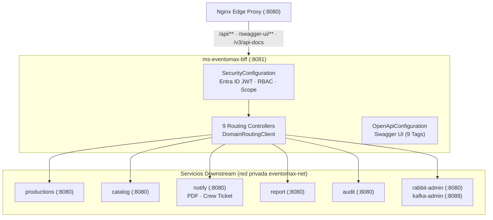

<a href="https://7dewsdyt7i.execute-api.us-east-1.amazonaws.com/swagger-ui/index.html">
  
</a>

> **Caso de Estudio 8:** Plataforma B2B de Producción y Montaje de Eventos &nbsp;|&nbsp; **Asignatura:** Desarrollo Cloud Native (`DSY1107`) &nbsp;|&nbsp; **Equipo:** Ignacio Valeria, Benjamín Flores, Benjamín Espinoza

## Propósito del Repositorio

`ms-eventomax-bff` es el **Backend for Frontend (BFF) y puerta de enlace única de APIs** de **EventoMax**. Recibe las solicitudes HTTPS enrutadas por AWS API Gateway y el Edge Proxy hacia `/api/**`, autentica cada petición y delega de forma controlada hacia los microservicios internos de dominio y administración de brokers:

- **Validación JWT Fail-Closed (`SecurityConfiguration`):** Verifica firma RS256, `iss` (`ENTRA_ISSUER_URI`) y `aud` (`ENTRA_AUDIENCE`) sobre tokens emitidos por **Microsoft Entra ID**, exigiendo el scope delegado `SCOPE_access_as_user` y al menos uno de los roles autorizados (`Admin`, `Productor`, `Organizador`, `Auditor`).
- **Propagación de Identidad y Anti-IDOR:** Reenvía los encabezados `Authorization`, `X-Correlation-Id` y `X-Actor-Oid` hacia los servicios downstream mediante `DomainRoutingClient`, de modo que `Organizador` solo pueda consultar o descargar recursos de sus propias producciones.
- **Contrato OpenAPI 3.1 y Swagger UI Nativo:** Expone `/swagger-ui/index.html` y `/v3/api-docs` en lectura pública (mientras todas las rutas `/api/**` exigen Bearer JWT), con 9 tags ordenados funcionalmente mediante `OpenApiConfiguration`.
- **Servicio Stateless:** No posee base de datos propia ni migraciones Flyway (`mem_limit: 640m`, puerto loopback `127.0.0.1:8081->8080`).

## Accesos en Vivo (Demo AWS)

| Recurso | Enlace HTTPS | Autenticación | Uso |
| :--- | :--- | :--- | :--- |
| **Swagger UI (API BFF)** | [Abrir Swagger UI](https://7dewsdyt7i.execute-api.us-east-1.amazonaws.com/swagger-ui/index.html) | Lectura pública | Inspección interactiva y pruebas con botón **Authorize (`Bearer <JWT>`)** |
| **Especificación OpenAPI JSON** | [Descargar `/v3/api-docs`](https://7dewsdyt7i.execute-api.us-east-1.amazonaws.com/v3/api-docs) | Lectura pública | Contrato OpenAPI 3.1 completo del BFF |
| **Portal Web EventoMax** | [Abrir Portal Web](https://eventomax-production-portal-app.s3.us-east-1.amazonaws.com/index.html) | OAuth 2.0 PKCE | Cliente SPA principal que consume este BFF |

## Matriz de Enrutamiento y Autorización RBAC

El orden de dominio configurado en `OpenApiConfiguration` agrupa las operaciones en 9 categorías:

| Dominio / Tag OpenAPI | Prefijo de Ruta en BFF | Roles Autorizados (`roles` + `access_as_user`) | Servicio Downstream |
| :--- | :--- | :--- | :--- |
| **Producciones** | `/api/productions`, `/api/productions/{id}`, `/api/productions/{id}/services` | `Admin`, `Productor`, `Organizador` (`POST` solo `Productor`, `Organizador`) | `ms-eventomax-productions` |
| **Producciones (Estado y Actas)** | `PUT /api/productions/{id}/status`, `POST .../quote-command/republish` | `Admin`, `Productor` | `ms-eventomax-productions` |
| **Producciones (Artefactos)** | `GET .../crew-ticket` · `GET .../quote-pdf` | `Admin`, `Productor` (y `Organizador` propio en PDF) | `ms-eventomax-notify` |
| **Organizadores** | `GET` / `PUT /api/organizers/{organizerId}/contact` | `GET`: `Admin`, `Productor`, `Organizador` · `PUT`: `Admin`, `Organizador` | `ms-eventomax-productions` |
| **Catálogo - Servicios** | `GET` / `POST` / `PUT /api/catalog/services/**` | Lectura: `Admin`, `Productor` · Escritura: `Admin` | `ms-eventomax-catalog` |
| **Catálogo - Equipos** | `GET` / `POST` / `PUT /api/catalog/equipment/**` | Lectura: `Admin`, `Productor` · Escritura: `Admin` | `ms-eventomax-catalog` |
| **Catálogo - Reservas** | `GET /api/catalog/reservations/production/{productionId}` | `Admin`, `Productor`, `Organizador` | `ms-eventomax-catalog` |
| **Reportes** | `GET /api/report/kpis`, `GET /api/report/top-services` | `Admin` | `ms-eventomax-report` |
| **Auditoría** | `GET /api/audit/timeline` | `Admin`, `Auditor` | `ms-eventomax-audit` |
| **RabbitMQ Admin** | `/api/rabbit-admin/queues/**`, `/exchanges/**`, `/bindings` | `Admin` | `ms-eventomax-rabbit-admin` |
| **Kafka Admin** | `/api/kafka-admin/topics/**`, `/consumer-groups/**` | `Admin` | `eventomax-kafka-admin` |

Las rutas `/actuator/health`, `/swagger-ui/**` y `/v3/api-docs/**` son públicas; el resto responde `401 Unauthorized` o `403 Forbidden`.

## Stack Tecnológico

<table>
  <tr>
    <td align="center" width="25%">
      <br />
      <strong>Java 25 · Boot 4.1.1</strong>
    </td>
    <td align="center" width="25%">
      <br />
      <strong>Entra ID (OAuth2)</strong>
    </td>
    <td align="center" width="25%">
      <br />
      <strong>Docker Container</strong>
    </td>
    <td align="center" width="25%">
      <br />
      <strong>AWS API Gateway</strong>
    </td>
  </tr>
  <tr>
    <td align="center" width="25%">
      <br />
      <strong>EC2 Apps Host</strong>
    </td>
    <td align="center" width="25%">
      <br />
      <strong>Proxy Rabbit Admin</strong>
    </td>
    <td align="center" width="25%">
      <picture>
        <source media="(prefers-color-scheme: dark)" srcset="docs/assets/tech/apache-kafka-dark.svg" />
        
      </picture><br />
      <strong>Proxy Kafka Admin</strong>
    </td>
    <td align="center" width="25%">
      <br />
      <strong>OpenAPI 3.1 UI</strong>
    </td>
  </tr>
</table>

## Arquitectura del Módulo



## Variables de Entorno e Integración

| Variable | Valor Referencial | Descripción |
| :--- | :--- | :--- |
| `ENTRA_ISSUER_URI` | `https://login.microsoftonline.com/<TENANT_ID>/v2.0` | Issuer JWT de Microsoft Entra ID |
| `ENTRA_AUDIENCE` | `api://<BACKEND_API_CLIENT_ID>` | Audience esperada en el token de acceso |
| `PRODUCTIONS_BASE_URL` | `http://ms-eventomax-productions:8080` | Upstream de producciones y organizadores |
| `CATALOG_BASE_URL` | `http://ms-eventomax-catalog:8080` | Upstream de servicios, equipos y reservas |
| `NOTIFY_BASE_URL` | `http://ms-eventomax-notify:8080` | Upstream de Actas PDF y Crew Tickets |
| `REPORT_BASE_URL` | `http://ms-eventomax-report:8080` | Upstream de KPIs y ranking analítico |
| `AUDIT_BASE_URL` | `http://ms-eventomax-audit:8080` | Upstream de bitácora de auditoría |
| `RABBIT_ADMIN_BASE_URL` | `http://ms-eventomax-rabbit-admin:8080` | Upstream de administración RabbitMQ (`demo.*`) |
| `KAFKA_ADMIN_BASE_URL` | `http://eventomax-kafka-admin:8088` | Upstream de administración Kafka |
| `DOWNSTREAM_CONNECT_TIMEOUT` / `READ_TIMEOUT` | `3s` / `10s` | Timeouts del cliente HTTP saliente |

## Pruebas y Despliegue

```bash
# Ejecutar suite completa unitaria e integración WebMvc / Security
./mvnw -B -ntp verify

# Levantar contenedor en red privada eventomax-net (mem_limit: 640m)
docker compose --env-file .env.prod -f docker-compose.prod.yml up -d --build
```
